# claude-mods

<p align="center"><a href="relevo/"></a></p>

Mods for [Claude Code](https://claude.com/claude-code) by Melkin Mosquera. Each mod is a Claude Code plugin with hooks and a panel in the terminal.

| Mod | What it does |
|---|---|
| [relevo](relevo/) | One Claude Code session plans; named workers (`builder`, `researcher`, `reviewer`…) build, research or review in parallel. In [Herdr](https://herdr.dev) the planner opens each worker in its own pane, links it, and reads every report together before the next step. |
| [decision-tree](decision-tree/) | Turns Claude's closing question, or its `AskUserQuestion` call, into a side panel: each option with what it implies, and a read-only forked session to try an answer before you confirm it. |

## Install

```
claude plugin marketplace add melandres8/claude-mods
claude plugin install relevo@claude-mods
claude plugin install decision-tree@claude-mods
```

Each mod's README (in Spanish) explains its commands, its protections, and how to develop it.

## Develop

From a mod folder:

```
claude plugin validate .
claude plugin test .
```

Claude Code generates `.claude-plugin/types/` with the engine types when it loads a mod. The folder is not committed.

---

**Español.** Mods de Claude Code: [relevo](relevo/) conecta una sesión que planifica con workers con nombre que trabajan en paralelo (en Herdr, los abre ella misma) y [decision-tree](decision-tree/) convierte la pregunta final de Claude en un panel con las opciones, lo que implica cada una y una rama de prueba de solo lectura. Instálalos con los comandos de arriba. Cada mod tiene su README en español.

## License

[MIT](LICENSE)
