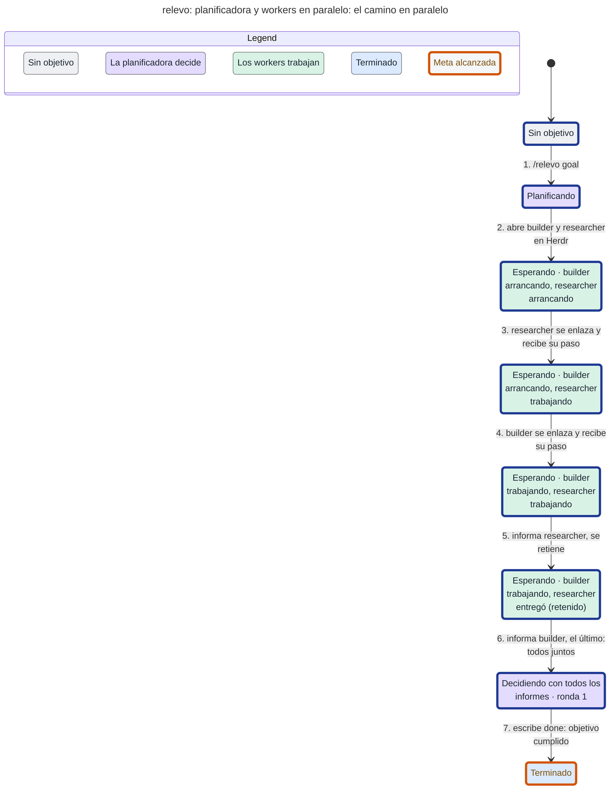
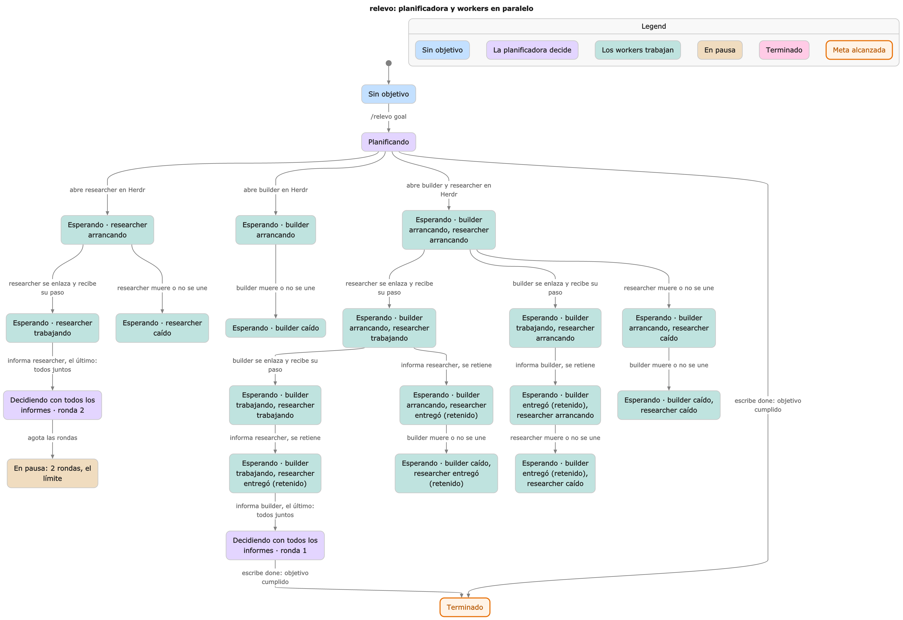

# relevo

<p align="center">
  
</p>

**Una sesión de Claude Code planifica. Sus workers construyen, investigan o revisan, en paralelo y cada uno en su propio pane.** relevo les pasa el trabajo de un lado a otro sin que tengas que copiar nada.

- **Workers con nombre, creados a demanda.** La planificadora escribe `<handoff to="researcher">…</handoff>`. Si ese worker no existe, relevo abre una sesión de Claude llamada `researcher` en un pane de [Herdr](https://herdr.dev), la enlaza y le entrega el paso.
- **En paralelo.** Varios `<handoff to="…">` en la misma respuesta salen a la vez, como una sola ronda.
- **Sin decidir con medio cuadro.** El informe que llega primero espera a los demás, y la planificadora los lee todos juntos en un solo turno.
- **Seguro por defecto.** Los enlaces van con confirmación y nonce, los mensajes que imita un modelo se descartan, y los nombres de worker se validan antes de tocar el shell. Hay límite de rondas y de workers.

## En 30 segundos

En una terminal de la app de Herdr, o en un pane del TUI `herdr`:

```
/relevo planner
/relevo goal crea un CRUD en FastAPI con tests
```

La planificadora divide el objetivo y reparte. Por ejemplo:

```
<handoff to="researcher">cómo pagina y valida el repo; solo leer</handoff>
<handoff to="builder">app/main.py, models y tests con pytest</handoff>
```

relevo abre `researcher` y `builder` en tu mismo tab, los dos trabajan a la vez, y cuando ha informado el último, la planificadora decide el siguiente paso o escribe `<done>`. La primera vez, Claude Code te pide permiso para el comando que abre los workers.

¿Sin Herdr? relevo sigue enlazando sesiones a mano: [dos sesiones](#con-comandos) o [varias](#workers-con-nombre).

## Cómo funciona

Este es el camino que recorre una ronda en paralelo, sacado de un modelo TLA+ del protocolo (más abajo, [modelo verificado](#modelo-verificado)):



1. **Reparto.** Al acabar el turno de la planificadora, relevo lee cada `<handoff to="nombre">`. Un `<handoff>` sin `to` va a `builder`. Si el mismo nombre aparece dos veces, vale el último bloque.
2. **Workers nuevos.** Para un nombre sin worker, relevo elige un uuid y lo abre:
   - **app de Herdr:** `hc run --bg --name <nombre> -- claude --name <nombre> --session-id <uuid> '/relevo join <nombre> <id-planner>'`, con las etiquetas `herdr.space` y `herdr.tab` de la planificadora, para que salga en su mismo tab;
   - **TUI de Herdr:** `herdr pane split` al lado (o debajo del último worker), `herdr agent start <nombre> --kind claude` y `/relevo join …` en su prompt.
3. **Enlace.** El worker pide el enlace desde su sesión. La planificadora lo acepta sola solo si llega del uuid que ella eligió, le responde a ese uuid guardado, y le entrega el paso retenido con la ronda de ese turno.
4. **Informes.** Cada worker cierra con su `<handoff>`, que vuelve con la cabecera `[relevo ronda N · de <nombre>]`. Mientras otro worker siga trabajando o arrancando, el informe queda retenido. El último trae todos en un turno.
5. **Fin o siguiente ronda.** La planificadora reparte otra vez, o escribe `<done>`.

Si un worker no llega a enlazarse, a los 90 s relevo se pausa y te dice dónde mirarlo (`hc read <nombre>` o `herdr agent read <nombre>`). Si muere ya enlazado, relevo no lo nota, porque un worker vivo puede tardar una hora: `/relevo status` lo sigue mostrando como `trabajando`. En los dos casos, `/relevo resume` deja de esperarlo y pasa los informes que ya han llegado. Un worker que nunca se enlazó se vuelve a abrir en la siguiente ronda.

## Activarlo

Elige **una** de estas dos formas. Si combinas dos, por ejemplo la instalación y `--plugin-dir`, los hooks se cargan dos veces y cada handoff sale duplicado.

**Instalarlo desde el marketplace** (recomendado). La raíz de este repositorio trae `.claude-plugin/marketplace.json`:

```
claude plugin marketplace add melandres8/claude-mods
claude plugin install relevo@claude-mods
```

Para trabajar sobre una copia local, pasa la ruta del clon en lugar de `melandres8/claude-mods`. Claude Code lee el plugin desde la carpeta misma. Tras editarlo, `/reload-plugins` lo recarga en la sesión abierta.

**Variable de entorno.** En `~/.claude/settings.json`, el de usuario y no el del proyecto:

```json
{ "env": { "CLAUDE_CODE_PLUGIN_DIRS": "/ruta/a/claude-mods/relevo" } }
```

En los dos casos relevo se carga en todas las sesiones. La banda solo aparece en las que tienen un rol.

## Enlazar sesiones a mano

Sin Herdr, o para enlazar sesiones que ya tienes abiertas. Llamamos **A** a la que planifica y **B** a la que construye.

### Panel

1. En A, escribe `/relevo`. Se abre el panel con tres pasos: **1** el rol, **2** la otra sesión (elígela en **Sesiones** o escribe su nombre o id en **Peer**; **↻** recarga la lista) y **3** **Conectar**.
2. **Conectar** envía a B una petición de enlace. B no toma ningún rol por su cuenta: muestra un aviso con el id de A y el comando que la acepta, por ejemplo `/relevo builder <id-de-A>`. El panel de B (`/relevo`) muestra la misma petición con un botón **Aceptar**. Acepta solo si ese id es de verdad tu otra sesión. Al aceptar, B responde y A muestra **✓** junto al peer.
3. En A aparece el campo **Objetivo**. Escríbelo y pulsa **Iniciar**.

Con el relevo en marcha, el panel muestra el último handoff enviado (↑) y el último recibido (↓), un handoff retenido si lo hay, y los botones **Pausa** o **Reanudar**, **Quitar** y **Cerrar**. En el móvil solo muestra el estado y los botones.

La banda sobre el prompt resume el estado en una línea: un punto del color del estado, el rol en una etiqueta de color (planner y builder tienen colores distintos), el peer, las rondas como barra `▰▰▰▱▱▱▱▱▱▱ 3/10` y quién tiene el turno, por ejemplo `turno de B · hace 12s`. Los colores salen del tema: verde activo, amarillo en pausa, rojo error, violeta terminado. **⚙** abre el panel.

### Con comandos

Lo mismo sin panel:

1. En A:
   ```
   /relevo planner <peer>
   ```
   Como `<peer>` sirve el sessionId de B, que `/relevo status` muestra en B, o el nombre con el que B aparece en `ListAgents` (también `nombre [ref]` si dos sesiones comparten nombre). La respuesta trae ya la línea para B, con el id de A: `/relevo builder <id-de-A>`.
2. En B, pega esa línea. Es la confirmación: acepta la petición de A y enlaza las dos sesiones.
   ```
   /relevo builder <id-de-A>
   ```
   Si B ejecuta la línea antes de que llegue la petición de A, la petición sale de B hacia A, y A la acepta igual, con `/relevo planner <id-de-B>` o con **Aceptar** en su panel. Si las dos peticiones se cruzan, acepta en una sola de las dos sesiones. Al enlazarse, la petición sobrante se descarta. Si las dos aceptan a la vez, las rondas se descartan como no verificadas: ejecuta `/relevo off` en las dos y enlázalas de nuevo desde una.
3. En A:
   ```
   /relevo goal Añadir paginación al endpoint /users con tests
   ```

### Workers con nombre

En Herdr la planificadora crea los workers sola ([cómo funciona](#cómo-funciona)). En cualquier otra terminal también puede tener varios: en cada worker, `/relevo join <nombre> <id-de-la-planificadora>`, y la planificadora, aunque ya esté enlazada, lo acepta con `/relevo planner <id>` o con **Aceptar**.

Un nombre de worker son minúsculas, dígitos, `-` o `_`, hasta 32 caracteres, y empieza por letra (la regla de Herdr). No vale `planner` ni ningún verbo de `/relevo`. Un `<handoff>` a un nombre que no cumple la regla no llega nunca al shell: se descarta con un toast.

Los panes que relevo abre siguen abiertos tras `/relevo off`, así que los cierras tú. En la app, los workers son hijos de la terminal de la planificadora: si cierras la planificadora, `hc` los cierra con ella. Para que el worker cargue relevo, instálalo desde el marketplace (o desde la ruta local del clon). Con `CLAUDE_CODE_PLUGIN_DIRS` el TUI lo hereda con `--env`; con `--plugin-dir` no se hereda.

## Comandos

| Comando | Qué hace |
| --- | --- |
| `/relevo` | Abre el panel. |
| `/relevo planner [<peer>]` | Esta sesión planifica. Si `<peer>` ya pidió enlazar como worker, acepta su petición, también estando ya enlazada. Sin `<peer>`, planifica sola y en herdr crea sus workers. |
| `/relevo builder <peer>` | Esta sesión construye. Si `<peer>` ya pidió enlazar como planner, acepta su petición. |
| `/relevo join <nombre> <peer>` | Esta sesión es el worker `<nombre>` (researcher, reviewer...). Es lo que relevo escribe en los workers que abre en herdr. |
| `/relevo goal <texto>` | Solo en la planificadora: arranca el ciclo. |
| `/relevo pause` / `resume` | Corta o reanuda el envío automático. `resume` envía los handoffs retenidos y pasa al modelo lo que llegó en pausa, o los informes retenidos de un worker que no responde. |
| `/relevo status` | Muestra rol, peers (en la planificadora, una línea por worker), ronda, último envío, lo retenido, el id de esta sesión (con rol o sin él) y la petición de enlace pendiente, si la hay. |
| `/relevo off` | Quita el rol. Una sesión enlazada rechaza `/relevo planner\|builder` hasta que ejecutas `/relevo off`. |

## Protecciones

- **`maxWorkers`** (por defecto 3, en `/config`): los workers que una planificadora enlaza o abre. Un `<handoff>` a un worker de más queda retenido y relevo se pausa.
- **Una ronda por turno**: un turno de la planificadora que reparte a tres workers gasta una sola ronda.
- **Informes juntos**: los workers trabajan en paralelo, y la planificadora no decide con medio cuadro. El informe de un worker queda retenido mientras otro al que dio trabajo siga ocupado o arrancando, y el último en llegar trae todos en un solo turno. Si un worker se cuelga, `/relevo resume` pasa al modelo los informes que ya han llegado.
- **`maxRounds`** (por defecto 10, en `/config`), en las dos sesiones: al llegar al límite, relevo se pausa, guarda el `<handoff>` pendiente y avisa con un toast. `/relevo resume` lo envía y concede otras `maxRounds` rondas. Si la planificadora reanuda pasado el límite, la constructora también se pausa al llegar al suyo y hay que reanudarla allí.
- **`<done>`** en la planificadora termina el ciclo, aunque la misma respuesta traiga también un `<handoff>`.
- **Sin enlace no se envía nada**: hasta que el peer acepta, o si los roles chocan (dos builders, por ejemplo), el `<handoff>` queda retenido y relevo se pausa. Cuando el peer acepta, `/relevo resume` lo envía.
- **Envío fallido o rechazado**: toast con el motivo y pausa. El `<handoff>` queda retenido, y `/relevo resume` lo reenvía con la misma ronda.
- **No a sí misma**: el panel no ofrece la propia sesión en la lista, y tanto el panel como `/relevo planner|builder` rechazan como peer el id de esta sesión.
- **Enlace con confirmación**: una petición de enlace nunca da un rol por sí sola. Queda pendiente hasta que la persona la acepta con `/relevo <rol> <id>` o con **Aceptar** en el panel. relevo no responde nunca a una petición que nadie aceptó, así que quien la envía no sabe nada de esta sesión ni de su peer. Un worker ya enlazado ignora las peticiones nuevas; una planificadora enlazada solo admite las de workers, y también con confirmación. La única excepción es el worker que la propia planificadora abrió en Herdr: se enlaza solo, y solo si la petición llega desde el uuid que ella eligió.
- **Solo mensajes de relevo**: un mensaje de enlace o de ronda cuenta solo si lo compuso el relevo de la otra sesión (origen `peer` con `plugin` `relevo`). Un texto igual escrito por un modelo con `SendMessage`, un mensaje `peer-send-message` o una entrada de buzón sin verificar se descarta con un toast, y no llega al modelo.
- **Nonce por enlace**: quien pide el enlace genera un nonce aleatorio. La aceptación lo devuelve, y cada cabecera de ronda lo lleva. Una ronda cuenta solo si trae el nonce del enlace y viene del rol opuesto. La ronda recibida nunca baja la cuenta, así que una cabecera `ronda 0` no la reinicia ni se salta `maxRounds`.
- **En pausa o terminado**: una ronda que llega entonces no abre un turno del modelo. Queda retenida (toast y línea en `/relevo status`), y `/relevo resume` se la pasa al modelo.
- **Sin eco**: relevo solo envía desde el final de un turno del modelo, nunca al recibir un mensaje. Tampoco reenvía un `<handoff>` igual al que acaba de recibir o al último que envió.

## Notas

- Si el modelo ya escribe la cabecera al principio del `<handoff>`, relevo la quita antes de poner la suya, así que el peer la lee una sola vez.
- Si dos sesiones comparten nombre, el panel las ofrece como `nombre [ref]`, la forma que acepta `SendMessage`. `/relevo planner|builder nombre [ref]` también la acepta.
- Solo la planificadora sube la ronda. Cada worker contesta con la misma ronda que recibió. En el envío, la cabecera es `[relevo ronda N · de <rol> · <nonce>]`, donde `<rol>` es `planner` o el nombre del worker. El modelo la lee sin el nonce, `[relevo ronda N · de <rol>]`, así que no lo ve nunca. Cada worker tiene su propio nonce, y una ronda cuenta solo con el del worker que la firma.
- Una cabecera o una línea de enlace cuentan solo al principio del mensaje (una línea de enlace, además, solo si es el mensaje entero). Un `<handoff>` que cita una de las dos sigue siendo un handoff.
- El `<handoff>` se lee de `answer` en `turn.complete`, que es el texto final del turno. Si ese texto no trae el bloque, relevo lee el último mensaje del asistente con `$.session.messages()`.
- El rol, el peer, la ronda y la pausa viven en `$.state`, así que aguantan una recarga en caliente.
- Un mensaje de otra sesión llega a `session.receive` dentro de su sobre `<cross-session-message …>`, tal como lo leería el modelo. relevo lee lo que hay dentro, así que la cabecera o la línea de enlace siguen contando solo al principio del cuerpo.
- Un mensaje del peer entra por `session.receive`. Los de relevo llegan con origen `peer` y `plugin` `relevo`. Según los tipos, ese nombre de plugin lo declara el motor que envía, no es una prueba de identidad. Por eso relevo lo usa solo como filtro, y la garantía la dan la confirmación de la persona y el nonce. Según los tipos de este build llega como un turno nuevo, o dentro del turno en curso si la otra sesión está ocupada. "Entregado" significa que está en cola, no que se haya leído.

## Modelo verificado

[`docs/model/RelevoHub.tla`](docs/model/RelevoHub.tla) modela el protocolo de la planificadora con dos workers y dos rondas. Cada acción nombra el hook de `hooks/register.tsx` que representa. [TLC](https://lamport.azurewebsites.net/tla/tools.html) recorre los 95 estados alcanzables y comprueba estas reglas en todos:

| Regla | Qué dice |
| --- | --- |
| `DecidesWithEveryReport` | La planificadora nunca decide mientras un worker al que dio trabajo sigue trabajando, arrancando o caído sin que nadie lo haya dado por perdido. |
| `HeldOnlyWhileWaiting` | Un informe solo queda retenido mientras la planificadora espera a los demás. |
| `RoundsCapped` | Ningún turno pasa de `maxRounds`. |

Las tres se cumplen. La meta, terminar tras leer juntos los informes de dos workers en paralelo, se comprueba como la regla `NeverFinishesInParallel`, que se espera rota: el contraejemplo que da TLC es el camino del diagrama de arriba. Es el mismo recorrido que hizo una prueba real con tres sesiones en Herdr.

<p align="center"><a href="docs/statechart.png"></a></p>

El diagrama completo dibuja el camino más corto a cada estado estable, más el de la meta: los repartos a uno o a dos workers, el informe retenido, las caídas y la pausa por `maxRounds`. El modelo deja fuera los mensajes falsificados y el nonce, que cubren los tests, y el contenido de los handoffs.

Para regenerarlo, con el [skill statechart de pstack](https://github.com/poteto/pstack):

```
node <pstack>/skills/statechart/scripts/statechart.mjs from-spec docs/model/RelevoHub.tla \
  --expect-broken NeverFinishesInParallel --cover --png \
  --title "relevo: planificadora y workers en paralelo"
python3 docs/make-hero.py docs/relevo-hub.svg
```

## Desarrollo

```
claude plugin validate .
claude plugin test .
```

Los tests cubren el enlace, las rondas, los mensajes falsificados, el reparto a varios workers, la creación en Herdr (con `hc` y `herdr` simulados), la espera a todos los informes y el sobre `<cross-session-message>`.
